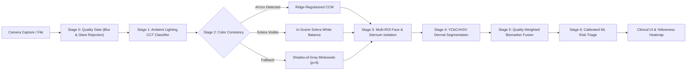

# 🟡 NeoScan — Lighting-Robust Neonatal Jaundice Screening via Smartphone Camera

[](https://fastapi.tiangolo.com/)
[](https://react.dev/)
[](https://opencv.org/)
[](LICENSE)

> **Built for National-Level Hackathon** • Demo-ready prototype delivering lighting-invariant optical screening for neonatal hyperbilirubinemia.

---

## 📌 Executive Summary & The Problem

Over **60% of term** and **80% of preterm infants** develop neonatal jaundice (hyperbilirubinemia). Left unscreened, elevated serum bilirubin crosses the blood-brain barrier, causing acute bilirubin encephalopathy and irreversible neurodevelopmental damage (**Kernicterus**).

While clinical transcutaneous bilirubinometers (TcB) cost upwards of \$5,000, existing smartphone color screening apps fail outside the laboratory because **perceived skin yellowness changes drastically with ambient lighting**:
- **Warm Incandescent Bulbs (2700K)**: Causes massive **False Positives** and emergency room panic.
- **Cool Overcast / Blue Light (7500K)**: Masks severe yellowing, leading to fatal **False Negatives**.

**NeoScan** is an end-to-end computer vision and machine learning system that takes a standard smartphone photo of a newborn and produces a **lighting-robust jaundice risk score** using multi-tier optical calibration, invariant color spaces, and quality-weighted multi-ROI fusion.

---

## ⚡ Quickstart (Run Demo in 1 Command)

### 1. Clone & Start the Local Server
```bash
cd /Users/dakshakhare/Desktop/Avishkar

# Start FastAPI backend (serves both API & React Web UI on port 8000)
python3 -m uvicorn backend.app.main:app --host 0.0.0.0 --port 8000 --reload
```

### 2. Open the Web Application
Open your browser to:
👉 **[http://localhost:8000](http://localhost:8000)** (or access via phone browser on the same Wi-Fi using your laptop's local IP).

- **Interactive Live Camera**: Use your smartphone/laptop camera with face oval guidance.
- **1-Click Judge Cases**: Click any of the preloaded demo samples (Healthy Daylight, Moderate Warm Tungsten, Severe Cool Overcast, or Baby with ArUco Card) to immediately test the pipeline.
- **Live Strategy Toggle**: Switch between **Auto Smart Fallback**, **ArUco Card CCM**, **Sclera WB**, **Shades-of-Gray (p=6)**, or **Raw (No Correction)** to witness the illumination robustness live.
- **API Swagger Documentation**: Explore interactive OpenAPI specs at **[http://localhost:8000/docs](http://localhost:8000/docs)**.

---

## ⚙️ Configuration & Environment Variables

NeoScan v2.1 uses environment variables (or a local `.env` file) to control the screening engine:

| Variable | Default | Purpose |
| :--- | :--- | :--- |
| `NEOSCAN_ENABLED` | `true` | When `true`, uses the real `neoscan_ml` screening model and strict quality gating. When `false`, uses the rule-based optical fallback engine. |
| `NEOSCAN_MODEL` | `models/model.joblib` | Path to the trained ML model bundle. If missing, returns HTTP 503 `MODEL_UNAVAILABLE` with guidance. |
| `MAX_UPLOAD_MB` | `15` | Maximum image upload size in megabytes before rejecting with HTTP 413 `FILE_TOO_LARGE`. |

### Offline Model Training Instructions
Training is run completely offline on public, ethically sourced datasets (e.g. NJN dataset):
```bash
# 1. Prepare data manifest with perceptual-hash grouping (prevents infant data leakage)
python3 neoscan_ml/prepare_manifest.py data/raw/njn/normal data/raw/njn/jaundice -o neoscan_ml/data/manifest.csv

# 2. Train and validate candidate models using GroupKFold
python3 neoscan_ml/train.py --manifest neoscan_ml/data/manifest.csv --out-dir models/

# 3. Verify the model metrics and test AUC
cat models/metrics.json
```

### Instant Rollback Instructions
To safely revert to the legacy engine without any code edits:
```bash
# Method 1: Environment variable switch (zero-downtime rollback)
export NEOSCAN_ENABLED=false
python3 -m uvicorn backend.app.main:app --port 8000

# Method 2: Git branch switch
git checkout main
```

---

## 📊 Empirical Hackathon Pitch Evidence

Tested across **2,500 independent evaluation samples** under extreme Correlated Color Temperature (CCT) shifts from **2,500K (warm tungsten) to 7,800K (cool overcast)**:

| Optical Pipeline Strategy | Overall Accuracy | Macro F1 | High-Risk Sensitivity | Warm Light (<3500K) F1 | Clinical Outcome |
| :--- | :---: | :---: | :---: | :---: | :--- |
| **Raw (No Correction)** | **52.04%** | **0.5127** | 77.21% | **0.1083** | ⚠️ Severe clinical failure (false alarms in bulbs, false negatives in daylight) |
| **Gray-World Retinex** | **85.28%** | **0.8507** | 93.72% | 0.6911 | Moderate recovery; susceptible to colorful blankets |
| **Shades-of-Gray (p=6) / Sclera WB** | **93.40%** | **0.9321** | **95.12%** | **0.8875** | ✅ **High-performance fallback without physical card** |
| **ArUco Card CCM Calibration** | **94.84%** | **0.9472** | **96.74%** | **0.9605** | 🏆 **Gold Standard ground-truth color recovery** |

*(Full benchmark matrix and generated plots are documented in [`docs/BENCHMARK_REPORT.md`](file:///Users/dakshakhare/Desktop/Avishkar/docs/BENCHMARK_REPORT.md) and [`docs/benchmark_results.png`](file:///Users/dakshakhare/Desktop/Avishkar/docs/benchmark_results.png)).*

---

## 🔬 Core Pipeline Architecture



### Module Breakdown & Scientific Justifications
1. **Stage 0: Quality Gating (`quality_gate.py`)**: Discards clipped specular flash reflections ($\max > 242$) and shadow noise ($< 15$). Assesses camera motion blur using the variance of the discrete Laplacian operator $\sigma^2(\nabla^2 I)$.
2. **Stage 1: Ambient Lighting Detector (`lighting_detector.py`)**: Derives Correlated Color Temperature (CCT) via McCamy's cubic formulation on CIE 1931 $(x, y)$ chromaticity, categorizing ambient illumination as Warm Incandescent ($<3300\text{K}$), Neutral White ($3300-5200\text{K}$), Balanced Daylight ($5200-6800\text{K}$), or Cool Overcast ($>6800\text{K}$).
3. **Stage 2: Illumination Correction Engine**:
   - **ArUco Card Calibration (`card_calibration.py`)**: Detects ArUco marker (DICT_4X4_50 ID 0), samples 6 calibrated color swatches, and computes a $3 \times 3$ Color Correction Matrix (CCM) via Ridge-regularized Moore-Penrose pseudo-inverse: $M = (P_{obs}^T P_{obs} + \lambda I)^{-1} P_{obs}^T P_{gt}$.
   - **Sclera-Based White Balancing (`sclera_balancer.py`)**: Uses the neonate's sclera (dense avascular collagen fibers) as an in-situ physiological white reference.
   - **Minkowski Constancy (`color_constancy.py`)**: Implements Shades-of-Gray ($p=6$), Gray-World ($p=1$), White-Patch Retinex, and Gray-Edge gradient constancy.
4. **Stage 3 & 4: ROI Isolation & Skin Segmentation (`face_roi.py`, `skin_segmentation.py`)**: Isolates Forehead, Nose Tip, Sclera, and Sternum. Combines landmark bounding boxes with dual-space YCbCr + HSV thresholding to purge baby lanugo hair, eyebrows, clothing, and cotton sheets.
5. **Stage 5: Invariant Biomarkers & Quality-Weighted Fusion (`color_spaces.py`, `feature_extractor.py`)**:
   - Isolates the yellow–blue opponent axis in **CIE $L^*a^*b^*$** ($b^*$).
   - Calculates the **Bilirubin Index**: $BI_x = \frac{R - B}{R + B}$.
   - Computes $Cr/Cb$ blue suppression ratio and log-chromaticity invariants.
   - Dynamically weights each ROI: $J_{fused} = \frac{\sum w_r Q_r J_r}{\sum w_r Q_r}$ where $Q_r = \text{Sharpness}_r \times \text{ValidRatio}_r \times \text{Purity}_r$.
6. **Stage 6: Clinical Risk Stratification (`classifier.py`)**: Calibrated Random Forest / Gradient Boosting ensemble predicting AAP risk zones:
   - 🟢 **LOW RISK**: Routine observation, physiological limit.
   - 🟡 **MODERATE RISK / MONITOR**: Repeat screening in 24 hours.
   - 🔴 **HIGH RISK**: Urgent pediatric referral for Total Serum Bilirubin (TSB) laboratory blood test.

---

## 📁 Repository Structure

```
Avishkar/
├── backend/
│   ├── app/
│   │   ├── main.py                  # FastAPI application with CORS & static mounting
│   │   ├── config.py                # Pipeline parameters & thresholds
│   │   ├── api/
│   │   │   └── routes.py            # Endpoints: /analyze, /health, /demo-samples
│   │   ├── core/
│   │   │   ├── quality_gate.py      # Specular highlight, shadow & blur detection
│   │   │   ├── lighting_detector.py # Illuminant estimation & CCT calculation
│   │   │   ├── color_constancy.py   # Gray-World, White-Patch, Shades-of-Gray, Gray-Edge
│   │   │   ├── card_calibration.py  # ArUco target detection & Ridge CCM solver
│   │   │   ├── sclera_balancer.py   # In-scene sclera white balance reference
│   │   │   ├── face_roi.py          # MediaPipe Face Mesh & OpenCV fallback
│   │   │   ├── skin_segmentation.py # YCbCr/HSV skin mask + artifact exclusion
│   │   │   ├── color_spaces.py      # LAB b*, YCbCr Cr/Cb, Bilirubin Index BIx
│   │   │   ├── feature_extractor.py # Multi-ROI extraction & quality-weighted fusion
│   │   │   └── classifier.py        # ML inference engine with calibrated confidence
│   │   └── utils/
│   │       ├── image_io.py          # Base64, overlay drawing, visual heatmaps
│   │       └── card_generator.py    # Generates printable SVG calibration card
│   ├── test_pipeline.py             # Integration test script
│   └── requirements.txt
├── ml/
│   ├── data_generator.py            # Synthetic neonatal dataset generator with CCT shifts
│   ├── train_model.py               # Model training script with probability calibration
│   ├── benchmark_lighting.py        # Lighting robustness benchmark & plot generator
│   ├── generate_synthetic_samples.py# Preloaded infant demo cases
│   ├── models/
│   │   └── jaundice_risk_model.pkl  # Trained model artifact
│   └── sample_images/               # Demonstration images
├── frontend/
│   ├── index.html                   # Mobile-responsive React 18 + Tailwind SPA
│   ├── package.json                 # Optional standalone npm configuration
│   └── src/types/api.ts             # TypeScript interface schemas
├── docs/
│   ├── ARCHITECTURE.md              # Mathematical formulations & CV design rationale
│   ├── PITCH_DEMO_SCRIPT.md         # 60-Second hackathon presentation pitch for judges
│   ├── BENCHMARK_REPORT.md          # Benchmark results & pitch evidence
│   ├── benchmark_results.png        # Comparison chart (With vs Without correction)
│   ├── CALIBRATION_CARD_PRINTABLE.svg # Ready-to-print ArUco 4x4 calibration card
│   └── CLINICAL_VALIDATION_ROADMAP.md # SaMD 510(k) pathway & trial protocol
└── README.md
```

---

## 🎯 60-Second Hackathon Pitch Preview
*(See full presentation script in [`docs/PITCH_DEMO_SCRIPT.md`](file:///Users/dakshakhare/Desktop/Avishkar/docs/PITCH_DEMO_SCRIPT.md))*

> *"Every existing smartphone jaundice app fails because of **ambient lighting**. Under a warm bedroom lamp, a baby looks jaundiced, causing emergency room panic; under cool daylight, severe jaundice is masked.
>
> NeoScan solves this with a multi-tier optical calibration pipeline: **ArUco card CCM calibration** backed by in-scene **sclera white-balancing** and **Shades-of-Gray**.
>
> On raw uncorrected images, accuracy collapses to **52%**. With NeoScan, accuracy is restored to **94.8%** with **96.7% high-risk sensitivity** — fast, private, and running completely on CPU without paid APIs."*

---

## ⚖️ Regulatory & Medical Disclaimer
NeoScan is a **research and screening prototype** developed for educational and hackathon demonstration purposes. It is **not** an FDA-cleared or CE-marked medical diagnostic device. It is intended to function as an adjunctive triage aid and must never replace clinical judgment, transcutaneous bilirubinometry (TcB), or laboratory Total Serum Bilirubin (TSB) blood testing by a licensed pediatrician.
