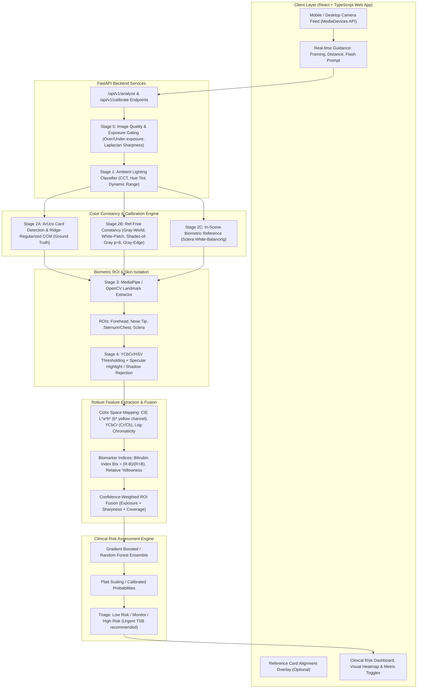

# NeoScan: Lighting-Robust Neonatal Jaundice Screening via Smartphone Camera
## System Architecture & Technical Design Document

---

### 1. Clinical Context & Computer Vision Challenge

**Neonatal Hyperbilirubinemia (Jaundice)** affects upwards of 60% of term and 80% of preterm infants in their first week of life. Left untreated, severe hyperbilirubinemia can cross the blood-brain barrier, causing acute bilirubin encephalopathy and irreversible neurodevelopmental damage (**Kernicterus**).

While Transcutaneous Bilirubinometers (TcB) and laboratory Total Serum Bilirubin (TSB) tests are gold standards, they require expensive specialized hardware ($3,000–$6,000) or invasive blood draws unavailable in community clinics, home monitoring, or low-resource settings.

#### The Core Technical Bottleneck: The Illumination Confound
Smartphone camera screening attempts to quantify the yellow discoloration of skin and sclera caused by bilirubin deposition (peak absorption $\lambda \approx 460\text{ nm}$). However, raw smartphone RGB values fail catastrophically in non-laboratory environments due to three confounding variables:
1. **Spectral Correlated Color Temperature (CCT) Shift**:
   - Indoor incandescent/warm halogen: $2700\text{K} - 3000\text{K}$ (heavy red/yellow spectral radiance $\to$ massive **False Positives**).
   - Overcast sky / blue LED: $6500\text{K} - 8000\text{K}$ (heavy blue spectral radiance $\to$ fatal **False Negatives**).
2. **Camera ISP Non-Linearities**:
   - Dynamic Auto White Balance (AWB), non-linear sensor response, auto-exposure clipping, and tone mapping curves vary across OEMs (Apple, Samsung, Xiaomi).
3. **Melanin & Erythema Variations (Fitzpatrick Types I–VI)**:
   - Skin pigmentation attenuates reflected light across spectrums, requiring chromaticity ratio normalization rather than naive intensity thresholding.

NeoScan solves this through a multi-stage **hybrid optical calibration and feature-invariance pipeline**.

---

### 2. High-Level System Architecture



---

### 3. Mathematical & Algorithmic Formulations

#### 3.1 Stage 0: Quality Gating & Saturated Pixel Elimination
Raw pixels with extreme intensities cannot carry chromaticity information due to sensor clipping:
$$\mathcal{M}_{valid}(x,y) = \mathbb{I}\left( \min(R,G,B) > \tau_{shadow} \land \max(R,G,B) < \tau_{specular} \right)$$
where $\tau_{shadow} = 15/255$ and $\tau_{specular} = 242/255$.
Sharpness is computed using the variance of the discrete Laplacian operator:
$$S = \text{Var}\left( \nabla^2 I_{gray} \right) = \frac{1}{N}\sum_{(x,y)} \left( \nabla^2 I_{gray}(x,y) - \mu_{\nabla^2} \right)^2$$
If $S < S_{min}$, the user is prompted to steady the camera.

#### 3.2 Stage 1: Ambient Lighting Condition Classification
The scene illuminant vector is estimated to provide contextual feedback to parents/clinicians:
$$\text{CCT} \approx 449 n^3 + 3525 n^2 + 6823.3 n + 5520.33 \quad (\text{McCamy's Formula})$$
where $n = \frac{x - 0.3320}{0.1858 - y}$, derived from CIE 1931 $(x,y)$ chromaticity coordinates.
Classes detected:
- **Warm Incandescent / Tungsten** ($< 3300\text{K}$)
- **Balanced Daylight** ($5000\text{K} - 6500\text{K}$)
- **Cool Overcast / Blueish Light** ($> 7000\text{K}$)
- **Under-exposed / Low-light** ($\mu_L < 35$)

#### 3.3 Stage 2: Color Constancy & Illumination Correction

##### Method A: Reference-Card Color Correction Matrix (CCM)
Using a 6-patch calibration target with ArUco marker $4\times 4$ for sub-pixel homography planar unwarping:
Let observed patch colors be $P_{obs} \in \mathbb{R}^{K \times 3}$ and standard laboratory ground-truth colors be $P_{gt} \in \mathbb{R}^{K \times 3}$.
The $3 \times 3$ Color Correction Matrix $M$ is estimated via Ridge-regularized Moore-Penrose pseudo-inverse:
$$M = \left( P_{obs}^T P_{obs} + \lambda I \right)^{-1} P_{obs}^T P_{gt}$$
The corrected image is obtained via affine or linear projection:
$$I_{corrected}(x,y) = I(x,y) M$$

##### Method B: Reference-Free Color Constancy (Minkowski Framework)
Under the generalized Retinex framework by van de Weijer & Gevers:
$$e_c(p, n, \sigma) = \left( \int \left| \frac{\partial^n I_c^\sigma(x)}{\partial x^n} \right|^p dx \right)^{1/p}$$
- **Gray-World**: $n=0, p=1$. Scaling illuminant factor $k_c = \frac{\bar{I}}{\bar{I}_c}$.
- **White-Patch Retinex**: $n=0, p \to \infty$ (implemented via 99th percentile intensity vector $e = [\max_{99} R, \max_{99} G, \max_{99} B]^T$).
- **Shades-of-Gray**: $n=0, p=6$. Optimal compromise between diffuse and specular reflectance.
- **Gray-Edge**: $n=1, p=1$. Assumes average spatial reflectance gradient is achromatic.

##### Method C: Sclera-Based White Balancing (Biometric In-Scene Reference)
The sclera is predominantly avascular dense fibrous tissue that remains physically near-white regardless of racial skin phenotype.
1. Extract eye landmarks $\mathcal{L}_{eye}$, mask iris/pupil by Otsu thresholding in saturation/intensity.
2. Calculate robust median chromaticity of sclera pixels: $\mathbf{e}_{sclera} = [\tilde{R}_s, \tilde{G}_s, \tilde{B}_s]^T$.
3. Correct the whole image such that the sclera aligns to neutral white ($[240, 240, 240]$):
$$I_{corr}(x,y) = \min\left(255, I(x,y) \odot \frac{240.0}{\mathbf{e}_{sclera}}\right)$$

#### 3.4 Stage 3: Illumination-Invariant Features & Biomarkers
Once color correction is executed, we transform to invariant color spaces:
1. **CIE $L^*a^*b^*$**:
   - $b^*$ represents the yellow–blue opponent channel ($b^* > 0 \implies$ yellow). Highly correlated with tissue bilirubin binding.
2. **YCbCr**:
   - $Cr$ (chrominance red) and $Cb$ (chrominance blue).
   - Bilirubin causes a distinct drop in $Cb$ and elevation in $Cr/Cb$ ratio.
3. **Bilirubin Index ($BI_x$)**:
   $$BI_x = \frac{R - B}{R + B}$$
4. **Log-Chromaticity Invariant Projection**:
   In natural scenes, changing illumination intensity scales $R, G, B$ identically. Working in log-chromaticity space:
   $$u = \ln\left(\frac{R}{G}\right), \quad v = \ln\left(\frac{B}{G}\right)$$
   shifts due to illumination color variations form linear trajectories, enabling projection orthogonal to the illumination line.

#### 3.5 Stage 4: Multi-ROI Quality-Weighted Fusion
Neonatal jaundice presents with a **cephalo-caudal progression** (Kramer's rule: face first $\to$ trunk $\to$ extremities).
We extract features across 4 clinical ROIs:
- **Forehead** ($w_{fh} = 0.40$): Earliest manifestation, high vascularity.
- **Nose Tip** ($w_{nose} = 0.25$): Cartilage backing, minimal subcutaneous fat variance.
- **Sternum/Chest** ($w_{chest} = 0.20$): Confirmatory for moderate-to-severe progression.
- **Sclera** ($w_{sclera} = 0.15$): Validates internal biological baseline.

Each ROI $r$ has quality score $Q_r = \text{Sharpness}_r \times (1 - \text{ClippedRatio}_r) \times \text{SkinPurity}_r$.
The fused feature vector is:
$$\mathbf{F}_{fused} = \frac{\sum_{r} w_r Q_r \mathbf{F}_r}{\sum_{r} w_r Q_r}$$

#### 3.6 Stage 5: Classification & Risk Stratification
Rather than predicting an uncalibrated continuous numeric TSB value (which carries legal liability and false precision risk), we predict calibrated risk categories aligned with the **American Academy of Pediatrics (AAP) Nomogram**:
1. **Low Risk** ($< 8\text{ mg/dL}$ equivalent): Safe for discharge / routine observation.
2. **Moderate Risk / Monitor** ($8 - 14\text{ mg/dL}$ equivalent): Repeat transcutaneous or smartphone screening within 24–48 hours.
3. **High Risk** ($> 14\text{ mg/dL}$ equivalent): Immediate clinical serum bilirubin (TSB) blood test and pediatric consultation required.

---

### 4. File & Module Structure

```
Avishkar/
├── backend/
│   ├── app/
│   │   ├── main.py                  # FastAPI app with CORS & static file mounts
│   │   ├── config.py                # Pipeline parameters & thresholds
│   │   ├── api/
│   │   │   └── routes.py            # REST endpoints (/analyze, /benchmark, /detect-card)
│   │   ├── core/
│   │   │   ├── quality_gate.py      # Specular highlight, shadow & blur detection
│   │   │   ├── lighting_detector.py # Illuminant estimation & CCT calculation
│   │   │   ├── color_constancy.py   # Gray-World, White-Patch, Shades-of-Gray, Gray-Edge
│   │   │   ├── card_calibration.py  # ArUco target detection & Ridge CCM solver
│   │   │   ├── sclera_balancer.py   # Sclera white balance reference
│   │   │   ├── face_roi.py          # MediaPipe Face Mesh & OpenCV DNN landmark extraction
│   │   │   ├── skin_segmentation.py # YCbCr/HSV skin mask + specular/hair exclusion
│   │   │   ├── color_spaces.py      # LAB, YCbCr, log-chromaticity, Bilirubin Index
│   │   │   ├── feature_extractor.py # Statistical feature extraction & quality-weighted fusion
│   │   │   └── classifier.py        # ML inference engine with calibrated confidence scores
│   │   └── utils/
│   │       ├── image_io.py          # Image decoding, base64 encoding, visual overlays
│   │       └── card_generator.py    # Generates printable SVG calibration card
│   └── requirements.txt
├── ml/
│   ├── data_generator.py            # Generates realistic synthetic neonatal dataset with CCT variation
│   ├── train_model.py               # Trains Random Forest / Gradient Boosting with CV
│   ├── benchmark_lighting.py        # Computes benchmark matrix: With vs Without correction
│   ├── models/
│   │   └── jaundice_risk_model.pkl  # Trained model artifact
│   └── sample_images/               # Seed baby images under different simulated illuminants
├── frontend/
│   ├── index.html                   # Mobile-responsive web UI entry point
│   ├── src/
│   │   ├── App.tsx                  # Full React SPA application
│   │   ├── components/
│   │   │   ├── CameraCapture.tsx    # Live camera feed, ArUco alignment guide, framing
│   │   │   ├── PipelineVisualizer.tsx # Side-by-side comparison & ROI masks
│   │   │   ├── MetricsDashboard.tsx # Color statistics, b* value, BIx, lighting tag
│   │   │   ├── CalibrationGuide.tsx # Guidance on reference card & lighting
│   │   │   └── ClinicalDisclaimer.tsx # AAP compliant warning banner
│   │   └── types/api.ts             # TypeScript schemas matching FastAPI responses
│   ├── package.json
│   └── tsconfig.json
├── docs/
│   ├── ARCHITECTURE.md              # This design document
│   ├── PITCH_DEMO_SCRIPT.md         # 60-second hackathon presentation pitch for judges
│   ├── CALIBRATION_CARD_PRINTABLE.svg # Ready-to-print ArUco 4x4 calibration card
│   └── CLINICAL_VALIDATION_ROADMAP.md # Limitations & future clinical trial protocol
└── README.md                        # Quickstart, local reproduction & architecture overview
```
