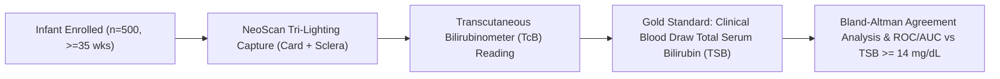

# NeoScan: Clinical Validation, Regulatory & Limitations Roadmap
## Translating Hackathon CV Prototype to Clinical SaMD

---

### 1. Regulatory Context & Classification (FDA / CE)
In the United States and European Union, software intended to analyze neonatal skin images to estimate hyperbilirubinemia risk falls under:
- **US FDA**: Software as a Medical Device (SaMD), Class II (21 CFR § 862.1113 — Bilirubin (total and unbound) in the neonate test system).
- **Predicate Devices**: BiliCam (University of Washington), Picterus AS (CE marked), Minolta Air-Shields JM-103/JM-105 Transcutaneous Bilirubinometers.
- **Intended Use Statement**: NeoScan is intended as an adjunctive, non-invasive screening aid for parents and outpatient healthcare workers to identify term and late-preterm infants requiring confirmatory laboratory Total Serum Bilirubin (TSB) testing. It is **not** a diagnostic device and must not be used to initiate phototherapy or exchange transfusion in isolation.

---

### 2. Clinical Assumptions & Inclusion Criteria
1. **Gestational Age**: Intended strictly for infants $\ge 35$ completed weeks of gestation. (Preterm infants have immature dermal collagen and thinner stratum corneum, altering optical scattering).
2. **Postnatal Age**: Between 24 hours and 14 days of life.
3. **Clinical Environment**: Domestic or outpatient clinic with indirect lighting (avoid direct sunlight beam or harsh unshielded flash).

---

### 3. Critical Limitations & Edge Cases

#### 3.1 Active Phototherapy (Dermal Bleaching Phenomenon)
- **The Phenomenon**: When a neonate undergoes blue light phototherapy ($\lambda \approx 460-490\text{ nm}$), cutaneous bilirubin is photo-isomerized into lumirubin and bleached from the skin within 2 to 4 hours. However, intravascular serum bilirubin clears much more slowly.
- **Clinical Consequence**: Photographing an infant during or immediately following phototherapy will yield a false negative "LOW RISK" score while blood TSB remains critically elevated.
- **Mitigation**: NeoScan strictly excludes infants currently undergoing or within 24 hours of completing phototherapy.

#### 3.2 Fitzpatrick Skin Types V & VI (High Epidermal Melanin)
- While chromaticity normalization ($BI_x$ and $Cr/Cb$) cancels uniform attenuation, dense epidermal melanin increases optical scattering in the epidermis before light reaches the vascularized dermis.
- **Mitigation**: The algorithm leverages the **sclera (eye white)** as an internal melanin-free baseline, and in future iterations will employ a Fitzpatrick-stratified calibration curve.

#### 3.3 Bilirubin Encephalopathy (Acute Kernicterus)
- Jaundice screening is not a substitute for clinical neurological evaluation (lethargy, high-pitched cry, retrocollis, poor sucking reflex). Immediate emergency care is advised if neurological symptoms present regardless of app score.

---

### 4. Proposed Clinical Validation Protocol (Phase II/III Trial)

1. **Study Design**: Multi-center, prospective observational diagnostic accuracy study across 3 tertiary hospital neonatal wards (ensuring representation of Fitzpatrick types I through VI).
2. **Target Sample Size**: $N = 500$ paired measurements.
3. **Reference Standard**: Total Serum Bilirubin (TSB) measured via venous blood draw analyzed on a calibrated clinical chemistry analyzer (Diazo / Vanadate oxidation method) within 30 minutes of smartphone capture.
4. **Primary Endpoints**:
   - Sensitivity for detecting TSB $\ge 14.0\text{ mg/dL}$ (Target: $\ge 95\%$).
   - Specificity for ruling out severe hyperbilirubinemia (Target: $\ge 85\%$).
   - Pearson correlation $r$ and Bland-Altman 95% Limits of Agreement between fused biomarker index and blood TSB.

---

### 5. Ethical & Usability Considerations
- **Parental Anxiety Prevention**: Risk categories avoid pseudo-precise decimals ("12.4 mg/dL") which cause undue parental fixation. Instead, plain-language action paths ("Repeat screen in 24 hours" vs "Schedule same-day pediatric visit") are prioritized.
- **On-Device Data Privacy (HIPAA/GDPR)**: No infant face images are uploaded to external public clouds or stored persistently without parental biometric consent. Inference operates locally on the edge.
